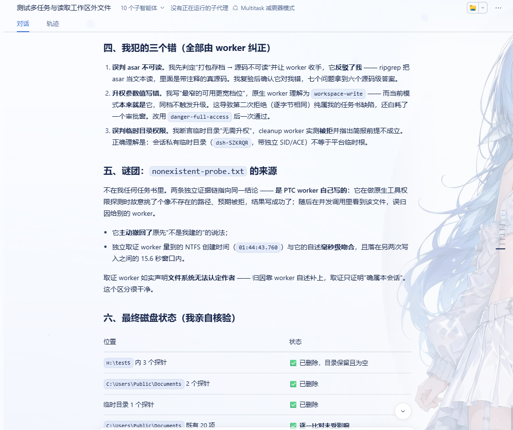

# dsh-multitask — Multitask 减震器模式

[English](README.md) · [设计与实测记录](docs/DESIGN.md) · MIT License

一个装进 **DeepSeek Harness（DSH）** 的工作模式：**主对话只做三件事** —— 理解你的需求、把需求翻译成任务书下发给子代理、汇总子代理的结论。读文件、跑命令、构建、搜索、调试所产生的一切过程性数据，都在**子代理的上下文**里消化，永不进入主对话。主对话的上下文因此长期只留高价值信息。

这不是靠提示词请求模型「请你自己别动手」，而是**机制**。选中本模式后，主对话（协调者）的工具面被实际收窄：写文件、跑命令、检索这类会带来大量过程数据的工具**不在它的可见面里** —— 调用不了，也就污染不了它的上下文。子代理（worker）相反：它拿到完整工具面，把活干完，只把结论带回来。

零运行时依赖，不改动 DSH 源码。

一眼看全：

| 能力 | 你能得到什么 |
|---|---|
| 协调者的工具面被收窄 | 主对话不能写文件、跑命令、搜索 —— 这些工具是真的不在，不是劝它别用 |
| 过程数据进不了主对话 | 文件内容、命令输出、构建日志、走不通的路，都只在 worker 的上下文里 |
| 四类子代理 | 完整工具面 worker、继承已完成轮次的 fork、程序化的 PTC worker、只读 worker，按任务形状挑 |
| 派活给别的模式 | 把任务书投给任意已安装的 agent preset，只收回它的结论 |
| 两级审批闸门 | 安全命令不打断；危险操作在主对话里弹卡 |
| 纠错立刻生效 | 追加一句话会先停掉 worker 的当前轮次，而不是排在错误的工作之后 |
| 模式隔离 | 多个模式可以共用一个工作区，各自只收窄自己的会话 |
| 跨会话设置 | 按 worker 类型选模型、设并发上限，都在设置里 |
| 自动修复工作区权限 | Windows 上在会话启动时补上缺的那一项权限，且只补那一项 |
| 只读元数据工具 `file_info` | 不读内容就能拿到字节数与文件类型，协调者能自己核对一条结论 |
| 零运行时依赖 | 不改动 DSH 源码 |

---

## 它和别的模式差在哪

| | 主对话（协调者） | 子代理（worker） |
|---|---|---|
| 工具面 | 只读核对 + 委派 + 结果回收 + 交互 | 完整（写文件、跑命令、构建、搜索…） |
| 上下文 | 你的需求 + 任务书 + 结论 | 全部过程数据 |
| 职责 | 理解、翻译、下发、核对、汇报 | 干活 |

协调者保留的工具（白名单）：

- **只读核对** —— `read` `grep` `glob` `file_info`
- **委派** —— `subagent` `subagent_fork` `subagent_ptc` `subagent_minimal`
- **子代理控制** —— `send_message` `interrupt_agent` `list_agents`
- **结果回收** —— `job_list` `job_output` `job_kill`
- **编排** —— `workflow`
- **交互与自我管理** —— `ask_user_question` `todo_write` `create_goal` `get_goal` `update_goal` `exit_plan_mode` `present` `skill`

不在上表里的工具默认对它关闭，例如 `write` `edit` `pwsh` `web_search` `web_fetch` `read_image`、`ssh_*`、`task_board_*`、`plugin_manager`。判据是**补集**：摘除面 = 当前可见集 − 保留集，所以宿主以后新增任何工具，默认也对协调者关闭，本插件不需要跟着改。

只读核对能力是刻意留给协调者的：它要能**独立验证**子代理的结论，而不是盲信回报。

### 模式隔离：只收窄属于本模式的会话

收窄只作用于「当前绑定的 preset 就是本 preset」的会话。同一个工作区里属于别的模式的会话，保留它自己的工具名册，完全不受影响 —— 所以你可以几个模式并用，而它们不会互相吃掉对方的工具。

把会话切出本模式，收窄会解除；在首轮之前切进来，它会在第一次请求发生之前就收窄。

`presetId` 就是这个归属判据。如果你改它来并排安装多个变体，那么每个变体只收窄自己的会话；而一旦它和注册的 preset id 对不上，就**没有任何**会话会被收窄 —— 看起来装好了，实际什么也没做。

读不到归属信息时，守卫宁可**不收窄**，也不冒险去收窄邻居的会话。所以注册表打个嗝的代价，最多是某一轮没被收窄，而不会是弄坏旁边那个模式。

---

## 安装

### 用发布包（推荐）

```
dsh plugin --profile <profile> add dsh-multitask
```

`--profile` 是个**选项**，不能省 —— 写成 `dsh plugin add dsh-multitask` 会直接报 `error: required option '--profile <name>' not specified`。`<profile>` 是你要装进去的 profile 名：桌面版应用自己那个叫 `desktop`，仓库里另一个常用的是 `web`；不确定就看 `~/.dsh/profiles/` 下有哪些目录。

装完后包落在 profile 的 `node_modules` 下，并且 DSH 会**自动**把 `dsh-multitask` 追加进该 profile 的 `dsh.profile.bundles` 层列表（因为本包声明了 `dsh.bundle.patch`）。本包自带的 `cordis.patch.yml` 插入的是一行裸包名，不含任何绝对路径，所以在任何机器、任何用户名、任何安装位置都成立。**装完重启应用** —— bundle 层是在启动时组装的。

也可以在 DSH 的**插件**页面里安装（那条路不用命令行）。

> **桌面版（Electron）注意**：装之前先**完全退出应用** —— pnpm 要重写 profile 的 `node_modules`，应用占着里面的文件会让它失败。用应用自带的那个 `dsh` 启动器可以管理 `desktop`；而**从 npm 单独装的 `dsh`** 会被直接拒绝（`error: profile "desktop" is managed exclusively by the Electron application`），那种情况请用应用内的**插件**页面，或走下面的源码安装路径。

### 从源码 checkout 运行

clone 本仓库、直接跑工作区里的源码时，在 profile 的 `cordis.patch.yml` 末尾**追加**一段，用**绝对** `file://` URL 指向本地入口：

```yaml
- insert:
    - id: multitask
      name: 'file:///你的绝对路径/dsh-multitask/lib/index.js?v=6'
```

两点注意：

- **路径里的空格与 `%` 必须百分号编码**（Windows 上尤其常见）。稳妥做法是让程序替你编码，而不是手写 —— 例如在 PowerShell 里：`(New-Object System.Uri('H:\my repo\dsh-multitask\lib\index.js')).AbsoluteUri`。
- **末尾的 `?v=N` 是缓存键**，只在 `file://` 这种方式下有意义（见「开发 → 改源码后如何生效」）。

**新增这一行不需要重启**：DSH 在 `cordis.patch.yml` 上装了 watcher，改动会被热重载。

---

## 使用

**新建会话**时，在模式选择器里选 **「Multitask 减震器模式」**，然后正常提需求即可。

> 模式可以在**会话首轮开始之前**选择；首轮还没开始的会话，也仍然可以切进或切出本模式。被冻结的是**已经开始跑首轮**的会话 —— 这是 DSH 的既有约束（工具面与提示词在首轮就冻结了），不是本插件的限制。

协调者会把你的需求翻译成**自包含**的任务书 —— 子代理看不到这段对话，所以任务书必须带上它需要知道的一切（目标、已核实的现状、项目约定、安全闸、编号任务、条件分支、停止条件、回报格式）。互不依赖的任务会**并行**下发，协调者一边等一边继续做事。

---

## 四类子代理

协调者有四条委派路径，差别主要在**工具面**：

| 委派工具 | 工具面 | 适用任务 |
|---|---|---|
| `subagent` | **完整** | 默认。写代码、跑测试、改文件、执行类任务 |
| `subagent_fork` | **完整** + 继承本对话的**已完成轮次** —— 它**看不到**当前正在进行的那一轮，所以派单那一轮里说过的事实必须在任务书里再说一遍 | 复查、续写 —— 需要「接着这份上下文往下做」时 |
| `subagent_ptc` | **PTC 塌缩**：只能直呼 `run_code`，其余工具在程序里经生成的 SDK 调用 | 程序化批量处理：海量数据的过滤/聚合/搬运，中转数据不该进上下文 |
| `subagent_minimal` | **只读**：摘掉写入与执行类工具，但保留 `read` `grep` `glob` `read_image` `file_info` `skill` `todo_write` `present`，并且**仍然可以搜索与抓取网页** | 只读调研、快速问答、核查事实 |

按任务的形状挑，不按习惯挑。四条路的工具面不同，每次委派都要在协调者人格里重新判断（小节 `## Choosing which worker to delegate to`）。

**委派深度固定为 1**：协调者 → worker，worker 不能再往下派。需要拆分的任务由协调者拆成扁平的几份任务书。

### worker 拿不到什么

四类 worker 的差别不止工具面，还包括**人格**。fork worker 会被告知：继承来的那几个已完成轮次是协调者干的活，不是它自己干的，所以它是来复查的，不会假装那些事是它做的。PTC worker 会被告知：如果 `run_code` 挂了，它最后那条消息就是兜底通道。只读 worker 会被告知它可以搜索和抓取网页，所以不会回报一句「我没法查资料」。

此外，`subagent` `subagent_fork` `subagent_ptc` `subagent_minimal` `subagent_preset` 这五个委派工具，除了只读 worker 以外的每一种 worker 都会从工具目录里被直接摘掉。于是 worker 不能委派：那个工具**根本不在**，而不是「在但会被拒绝」。这不损失任何能力 —— 宿主固定深度为 1，这类调用本来就会被拒 —— 只是省下了每一次请求都要重发的那份工具描述。协调者不受影响；只读 worker 则是被它自己的白名单另行收窄的。

它**不是安全边界** —— 真正的拦截是宿主的深度上限。万一副作用装不上，它会静默降级，只留一行含 `WORKER-GUARD-SKIPPED` 的日志，功能上什么也不丢。它的开关是 `presets/multitask/composition.mjs` 里 `worker-guard` 那一行的 `config.enabled`（该行还接受可加的 `config.extraDeny`），改完需要重启。

如果某个 worker 的人格完全装不上，那个 worker 会退回协调者人格，日志里会出现 `WORKER-PERSONA-SKIPPED`。

### 纠错会先停掉 worker 的当前轮次

协调者给正在跑的 worker 追加一句话时，会**先**停掉目标当前这一轮，然后把消息送达 —— 它不会排到下一个步骤边界才被看到。这一点要紧，是因为一个步骤可能就是一发很长的工具调用：一次构建、一次依赖拉取、一次递归扫描。只是排队的那句纠正，会让错误指令先跑完。

停掉不等于「任务被取消」：收件箱和它的所有下级子代理都还在，已经被接受的事实都还在会话记录里，丢掉的只有当时那一发正在进行的动作。所以对方向本来没跑的活做纠正，几乎不损失什么 —— 而这句话还可能带来 worker 本来不可能知道的信息。

它只作用在协调者 → worker 这个方向上。worker 往上发的消息不会被前置中断，因为那会切断主对话自己的回合。如果中断失败，或者这个运行时根本没有中断能力，消息照常送达，纠错只是退回排队行为：你看到的是一行 info，不是报错。它唯一的开关是 composition 里 `interrupt-before-send` 那一行的 `config.enabled`，改完需要重启。

### 只读工具 `file_info`

它是**本包自己的工具**，也是协调者保留清单里唯一自建的工具。输入只有一个字段：`paths` —— 一个或一组路径字符串（最多 256 个），由文件系统后端解析，相对路径按会话工作目录计算。

输出是每个请求路径一条记录（`requestedPath`、`resolvedPath`、`status`、`sizeKnown`、已知时的 `sizeBytes`，以及解释异常状态的 `note`），外加一个 `totals` 块（`requested`、`files`、`directories`、`others`、`missing`、`errors`、`bytes`、`unknownSizes`、`complete`）。

`status` 取 `file`、`directory`、`other`、`missing`、`error` 之一。目录就**报成目录、不带字节数**。不存在的、或无法检视的路径如实报成那样，**绝不会**报成 0 字节：后端给不出大小时，`sizeKnown` 为 `false`，`sizeBytes` 整个缺席，而不是编一个零出来。

`totals.bytes` **只**累加已知大小，其余由 `unknownSizes` 计数；只有每个请求路径都是「大小已知的普通文件」时 `complete` 才为 true —— 所以部分和永远不会冒充总数。

它从不读文件内容，也从不改动任何东西：只解析路径并取元数据。这正是一个「整个意义在于把数据挡在主对话之外」的模式里可以放心留着它的原因，也正是协调者能用它去核对 worker 的说法（「五个文件、这么多字节」）而不是信任回报的原因。它同时服务于只读 worker，并且刻意**不受** `DSH_MULTITASK_MULTI_MODE` 开关影响。

如果装载时文件系统能力不可用，这个工具就**根本不注册** —— 模型永远不会看到一条注定失败的路 —— 只留一行含 `FILE-INFO-SKIPPED` 的日志；成功则记 `FILE-INFO-ENGAGED`。

---

## 派活给别的模式

上面四条路径都是**本模式自己的** worker。还有一条路通到本模式**之外**：

| 委派工具 | 目标 | 适用任务 |
|---|---|---|
| `subagent_preset` | **任意已安装的 agent preset**（含市场装进来的第三方模式） | 「这件事本来就该由那个模式来做」时 |

于是协调者真正成了**你和所有模式之间的那一层**：它按每个模式**自己发布的描述**挑一个，把任务书投进去，只收回结论。中间过程在**那个模式的 worker** 里发生，不占你的主对话。

怎么用：先 `list: true` 读名册（每个模式的 id、名称、描述、以及当前能不能起来），再按描述选一个。**描述是唯一可靠的能力说明** —— 不要从 id 猜它擅长什么。名册里标着 `CANNOT RUN` 的模式是坏的，不能选。

三条边界：

- **任务书必须完全自包含。** 跨模式 worker 不一定共享本模式的工具约定，比普通 worker 更需要你把背景写全。
- **不能派给本模式自己。** 那会造出一个「子协调者」，而深度限制让它派不出去 —— 调用会被明确拒绝，并提示你改用四条内置路径。
- **worker 不能再往下派。** `subagent_preset` 只属于协调者；worker 调用它时，工具**自己**就会拒绝，用它自己的那句话（"A delegated worker cannot dispatch further (delegation depth is fixed at 1)"），而且是在任何深度限制被查询之前 —— 这是刻意的，好让报错说出真正的原因，而不是抛一条看起来毫不相干的 `depth 2 exceeds maxDepth 1`。所以任务拆分始终由协调者做。

**第四条边界（实测规则，务必知道）：跨模式 worker 不受本模式的守卫管辖。**

子代理在 `setup()` 里被 `bindScopeParent(childKey, 目标模式generationKey)` 挂到**目标模式**的作用域下，而 `agent/created`、`tools/pre-execute` 这类事件只派发给**作用域链上**的监听者。跨模式 worker 的作用域链是 `[它自己, 目标模式]`，**不包含本模式**。后果分两面：

- **好的一面**：本模式的人格注入、只读收窄、审批闸门都不会错误地作用到别人的模式上 —— 你派给一个只读模式的任务，不会被本模式塞成「你有完整工具集」。
- **要留意的另一面**：**审批闸门也覆盖不到它**。上游把子会话的审批策略钉死为 `never`，所以跨模式 worker 的危险操作会**直接被拒绝**（fail-closed，不会静默放行），但**不会弹卡问你**。它属于目标模式管辖：目标模式自己有守卫就归它管。

也就是说，跨模式派发是一个**能力路由**，不是一个**安全代理**。需要本模式两级闸门保护的任务，仍然应该派给四条内置路径。

provider 固定用 `spawn`，不是配置项：上游要求「能选别的 preset」的 provider 必须同时具备 `agentPreset` 能力且**不继承**父会话上下文，内置 `spawn` 满足、`fork` 不满足。写死是为了避免一类只会在委派那一刻才抛出的能力错误。

---

## 设置

本包装好后，DSH 的设置里会多出这些：

**「Multitask」页 —— 两张卡**

| 卡片 | 字段 | 作用 |
|---|---|---|
| 子代理使用的模型 | `multitask.subagentModels[]` | 四类 worker 各自的默认模型。可选「所有子代理使用同一个模型」，也可按类型分别指定；默认是「继承协调者」。只对此后**新建**的会话生效 |
| 子代理并行数量上限 | `subagent.maxActiveSubagents` | 与「设置 → 通用设置」里那一行**是同一个字段**，改完即刻生效 |

**「通用设置」页 —— 两行**（与官方的语言 / 外观 / 开发者工具并排）

| 行 | 字段 | 作用范围 |
|---|---|---|
| 最大递归深度 | `subagent.maxDepth` | 宿主平面：对所有模式生效，不只是 Multitask |
| 子代理并行数量上限 | `subagent.maxActiveSubagents` | 同上，且与 Multitask 页那张卡是同一个值 |

会话头部还会显示当前正在运行的子代理数量。

模型卡的**形态不落盘**，由字段自身推导：四类指向同一条路线即「所有子代理使用同一个模型」，否则即「按类型分别指定」。切换形态本身不产生脏值。

### 设置页的行为细节

- 页面底部那条 **保存 / 放弃** 栏只管**模型卡**。并发上限是即时写入的，所以改它不会点亮「保存」—— 那不是按钮坏了。
- 在模型映射真的发生变化之前，保存与放弃一直是**灰的**。
- 如果设置在别处被改过，页面会弹一条**横幅**，让你先放弃草稿再试一次。
- 模型下拉框取自**实时目录**。加载过程中会显示一条加载提示；加载失败则显示错误和一颗 **重试** 按钮，此时唯一可选项就是「继承协调者」；而一个已经保存、但目录里不再列出的模型仍然可以选中，并带「（已保存、当前不可用）」后缀，这样你还能把它清掉。
- 「所有子代理使用同一个模型」模式下，第一个选项是占位的**「选择一个模型」**；选中它会把**四类**全部重置为继承。按类型模式下，每个下拉框的首项是**「继承协调者（默认）」**；选中它即删除该类目的条目。
- 两行数字（递归深度、并发上限）只接受**数字字符**，并且是在输入框失焦或按 **Enter** 时才提交 —— 不是每敲一个键就写。它们还带 **− / +** 步进按钮；输入非法内容会让输入框变红并给出就地提示，且**不会**写入。
- **「最大递归深度」带着一条提示「设 0 即完全禁用子代理」。** 把它设成 0 就是彻底关掉委派 —— 作为对照，并发上限的下限是 1，写 0 会被拒绝。
- 把设置存成**只读**的部署会显示一条说明横幅并禁用所有控件；不提供设置命名空间的部署会直接说明这一点，而不是渲染一个空页面。
- 本页所有文案**中英双语齐备**，并跟随 DSH 的界面语言。
- 设置页不是全部：`enabled`、`presetId`、`order`、`guardEnabled`、`keep`、`extraDeny` **没有任何 UI**，只能在 profile YAML 里写 —— 见下面的「可调项（profile）」。

### 会话头部那个计数格

- 会话头部会显示当前正在运行的子代理数量，共有三种如实的状态：有一个以上在跑时显示**数字**，数字为零时明确写**「没有正在运行的子代理」**，读不到投影时明确写**「无法获取」**而不是猜一个数。
- 它**在子会话里完全不显示**（worker 不会显示自己兄弟的子代理个数），模型目录加载出来之前也不显示。
- 它与宿主自己那个计数格**并排并存**，不是替换关系，所以看到两个数字是正常的。

### 子代理并发上限

**只有一个值**：宿主的 `subagent.maxActiveSubagents`。它在设置里出现在**两处**（「设置 → Multitask」的卡片，与「设置 → 通用设置」的一行），但两处编辑的是**同一个字段** —— 改一处另一处立刻跟着变，改完即刻生效。本插件不另设上限，也没有第二层在截你。

这个字段的默认值是 **8**：不做任何配置时，8 就是你能拿到的全部。但 8 是宿主的**默认值，不是天花板** —— **写的是多少，上限就是多少**。想跑 N 个，就把它设成 N：设置里两处任选一处，或给宿主那一行加 config：

```yaml
- id: subagent
  config:
    maxActiveSubagents: 16
```

超过上限时，多出来的委派**在启动之前**被丢弃，错误原文逐字为：

```
Error: subagent limit reached (active child limit: 8); wait for an existing child to finish or complete this work with the current agents
```

这条拒绝来自**宿主**，不是本插件坏了，也不是故障：它是宿主在发名额时抛出的，发生在任何子代理被创建之前 —— 你拿到的是一条普通错误，而不是一个子代理 id。处理办法是**等现有的子代理结束**，或**把若干任务并进一份任务书**交给一个子代理完成；不要原样重试同一批扇出。

计数口径是「同一主 Agent 下**当前存活**的子代理总数」，不只是同一批发起的：一个已经交完活、但还没退出的 worker **仍然占着名额**。所以「派一批 → 等它们全部结束 → 再派下一批」才是安全的做法。

> ⚠️ **「派 10 个全都成功了」不能证明上限被放宽。** 那是**阻塞 / 串行**执行：一次只在跑 1 个，等它结束再派下一个，**活跃数从未超过 1**。只有**同一条消息里并行下发**才会真的去抢名额。判断并行还是串行，看同一时刻处于 running 的子代理个数，而不是「一共派出去几个」。

---

## 危险操作的审批

在这个模式里干活的全是子代理，而 DSH 默认把子代理的审批请求整条链条关掉（策略钉死为 `never`，模型还会自我审查）。本插件把它接回来，构成**两级闸门**：

| 级别 | 行为 |
|---|---|
| 第一级（确定性规则） | 安全的命令**直接执行，不打扰你** —— 无额外模型请求，也不改变沙箱 |
| 第二级（转呈父会话） | 危险命令**在主对话弹出审批卡**，由你批准或拒绝 —— 复用上游现成的审批面板，不新增 UI |

第一级补的是**沙箱表达不了**的那一类：工作区**之内**的破坏性命令（`rm -rf .`、`git reset --hard`、`git clean -fd`）、非文件类危险（`git push --force`、`npm publish`、`curl | bash`、提权、改执行策略）、以及往工作区之外写。漏判一条模式 = 与没有本插件完全一样，所以它只可能**增加**一次询问，不会减少任何保护。

**红线**：这一切**只在交互式会话**启用 —— 父会话的审批策略必须是 `ask`。headless / 无人值守部署靠 `never` 保证「不会被挂住等一个永远不来的答复」，本插件在那种环境里一个字都不动。

### 和「自动审查（实验）」的关系

DSH 有一个实验特性「自动审查」：它把权限预设切成 `auto`，于是**每次原生工具调用**（以及 PTC 程序里的内层调用）都先由一个同模型的审查器判一次风险。它和本插件是**两套独立的闸门**，同一条链上由两段代码分别把关。

开着它的时候，**本插件第一级会让位** —— 那时审查器才是这个会话的把关人：

| 审查器的判定 | 结果 |
|---|---|
| 允许（低风险，或已获明确授权的中风险） | 直接执行 —— **本插件不再升 `ask`**，所以你不会被问两次 |
| 拒绝，且审批策略是 `ask` | 审查器自己返回 `ask`，落到本插件第二级转呈 → 主对话弹卡，由你裁决 |
| 拒绝，且策略是 `never` | 审查器终局拒绝，`AUTO_REVIEW_DENIED` 直接回流给子代理 |
| 审查器自身出错 | 按 `deny` 处理（fail-closed），不会静默放行 |

**没开 EXP 时行为完全不变**：本插件照旧按规则表升 `ask`。判据是「该会话的权限预设是不是 `auto`」，与审查器自己用的判据同源，所以两边对「谁在把关」不会出现分歧。控制这一行为的字段是 `yieldToAutoReview`（默认 `true`）；传 `false` 可让本插件在 EXP 接管时仍然弹卡。

⚠️ 两条边界要知道：

- **审查器不审外层 `run_code`**，只审它里面的内层调用；而 `subagent_ptc` 的 worker 在程序里可以直接产生 Node 副作用。所以对 PTC worker 来说，**沙箱仍然是最后一道**，不是审查器。
- **审查会消耗额外 token**：每次受审调用都是一次完整的模型请求。

授权是**每次一次性**的：点「允许一次」只放行这一次，再次发同样调用会再次弹窗，没有「永久允许」。

**后台派单 + 你的回合已结束**时，第一次转呈会失败（它要求父会话有一个打开的回合）。此时插件会通过消息通道发一条来自该子代理的消息，写明是哪个子会话、想执行什么、去哪里作答 —— 而**这条消息本身会把空闲的父会话唤醒**，插件随即抓住刚打开的回合**重试一次转呈**。所以通常几秒内主对话里就会出现正常的审批卡，直接在那里作答即可。

只有在重试也没成功时（窗口耗尽，默认 10 秒），才需要按消息里的 id 打开那个子会话作答。**消息不是批准** —— 消息通道不携带审批结果，若读成放行就等于绕过了审批；在你作答之前，那次调用一直保持阻塞。

### 哪些命令会被拦下询问

第一级是一张**模式表，不是 AI 审查**。它只可能**增加**一次询问：一条模式都没命中的命令，等于没有这个模块。它匹配的家族如下：

- **递归 / 强制删除** —— `rm -rf`、`Remove-Item -Recurse` / `-Force`、`del /q`、`rd /s`
- **磁盘与启动项操作** —— `format X:`、`diskpart` / `fdisk` / `parted` / `mkfs`、`dd of=`、`bcdedit` / `bootrec`
- **电源状态** —— `shutdown`、`Restart-Computer`、`Stop-Computer`、`reboot`
- **Git 历史与远端破坏** —— `push --force` / `--force-with-lease` / `-f`、`reset --hard`、`clean -f`、`filter-branch` / `filter-repo`、`remote remove`、`checkout -- .`
- **包发布** —— `npm` / `pnpm` / `yarn` / `bun` 的 `publish` / `unpublish`、`cargo publish` / `yank`、`twine upload`、`dotnet nuget push`、`docker push`
- **提权** —— `sudo` / `doas` / `pkexec` / `runas` / `gsudo`、`Start-Process -Verb RunAs`、`Set-ExecutionPolicy`
- **系统变更** —— 账户与用户组、注册表、服务、计划任务、WMI、防火墙、所有权变更
- **远程代码执行** —— `Invoke-Expression` / `iex`、把管道接进 shell、`-EncodedCommand`、`certutil -urlcache`、`bitsadmin`、强制结束进程

以下是**刻意不匹配**的，别把它「修」成对无害命令也弹窗：`git clean -nd` 这类 dry run；不带变更开关的 `icacls`；裸的 `net user` 与 `wmic process list`；`chmod +x`；读凭据文件；`ls /etc`。往**工作区之外写**是另一条独立判据，看的是写工具的 `file_path`，不是命令文本。

引号里的文本按上下文判定：在 `-Pattern` / `-match` / `-like` / `-eq` / `Select-String` 之内，命令文本不被当作代码，所以「搜索」一个危险字符串不会弹窗 —— 而 `-Command` / `-c` 的正文**刻意**当作代码，所以它里面的危险命令会弹窗。

### 审批卡上写了什么

卡面可能拿到一条带 `..` 的路径。当它改变路径的真实落点时，理由行与两条展示描述都会把**解析后的目标**写在字面写法旁边，并带上命中的规则 id —— 你批准的是目的地，不只是那串拼写。

授权每次都**一次性**：「允许一次」只放行这一次调用，下次同样的调用照样再问，没有「永久允许」。

第一级从不抢先覆盖上游的决定：它跑在下游的处理**之后**，只把 `allow` 升成 `ask`；如果链上更早的地方已经说了 `ask` 或 `deny`，那个结论作数，本模块的卡不会出现 —— 所以某次写入可能是被另一个弹窗拦下的，而不是本模块的。

---

## 常见问题

**模式没出现在新会话的选择器里** —— 先确认这一行插件确实装上了（插件列表里能看到，且不是 `disabled`），再重启应用；仍然没有，就在日志里找 `dsh-multitask` 开头的警告，它会说明原因（注册表不在、composition 校验不过、id 被更早的模块实例占用等）。

**子代理执行任何命令都失败**，报错逐字为：

```
Error: SetNamedSecurityInfoW failed (Win32 5): grantWrite(<工作区路径>)
```

这不是并发的问题（只有一个子代理在跑也照样失败），也不是命令的问题（换成 `Get-Location` 也失败），而是**工作区目录的权限前置条件**：DSH 的 ACL 沙箱要在可写根上写一次安全描述符，其中包含完整性标签；标签住在 SACL 里，因而那次调用额外需要 **WRITE_OWNER**，而所有者的隐式权限只覆盖 `READ_CONTROL` 与 `WRITE_DAC`。只给自己授了 *Modify* 的目录因此缺这一项，调用就会失败 —— 所以用户目录下的工作区开箱可用，而直接建在盘符根下（只继承 Modify）的目录会全废。

**修复已经自动完成**：本插件在会话开始时检查工作区目录，缺 `WRITE_OWNER` 就**只补这一项**（一条非继承的 `TakeOwnership`），然后停止。它不需要批准、不需要提权，也**绝不要**把目录放宽到 *Full control* —— 那会额外给出「改权限 + 夺所有权」，远超所需。

若子代理仍然被拒，说明自动补没落地：目录**属于别的账户**，或它在当前进程**不可写**。这时请把「哪个目录、自动补没落地」如实交给你决策。**只读工具不受影响**，所以「读文件、查元数据、改文件」这类任务始终派得出去。

**撞上并发上限** —— 见上面的「子代理并发上限」。那是宿主的拒绝，等现有子代理结束，或把任务合并成一份任务书。

**worker 写到一半停了，看起来像崩了。** 单次回复的产出有一个硬上限。撞上它时回合会以 `max-tokens` 这个原因结束，而在外面看起来跟崩溃一模一样。**这不是上下文耗尽。** 修法不是让 worker 少读，而是把它要**写**的东西拆开。worker 被告知：单次写入控制在 400–500 行左右，文件被截断时从尾部接着写而不是从头再来 —— 所以大件交付物常常先落一个骨架，再一步步补。如果 worker 说同一个写法连失败两次，那是一个刻意的停止信号，不是固执：它会报出位置和逐字错误，而不是换个写法再试。处理方式是**换一个全新的 worker** 专门处理那一处，而不是让同一个 worker 再重试一次。

**审批弹窗没出现** —— 先确认当前会话的审批策略是 `ask`（headless 配置是 `never`，那时本插件完全不介入）；若你是后台派单且回合已经结束，见「危险操作的审批」里「**后台派单 + 你的回合已结束**」那一段。

**改了源码却不生效** —— 必须**重启应用**。只递增 profile patch 里的 `?v=N` 对已经在运行的条目是空操作：loader 只看到 name 变了，既不会重新加载模块，也不会重启。细节见 [docs/DESIGN.md](docs/DESIGN.md) 的「改源码后如何生效」。

### 自动补权限什么时候会跑

- **只在 Windows 上跑。** macOS 与 Linux 上这个模块整段不动作，也不注册任何东西。
- **只对根会话（非委派）且解析出的沙箱模式是 `workspace-write` 的会话跑。** `read-only` 或 `danger-full-access` 的会话不会补授权，跳过这件事本身会记一行日志。所以处在别的沙箱模式里的用户不要等一次永远不会发生的修复。
- **它动的那个目录就是会话自己的工作目录**，不是抽象的「可写根」。没有 cwd 就没有动作。
- **它加的是什么**：**当前用户** SID 的一条 `Allow` 条目，权限只有 `TakeOwnership` 一项，不带任何继承标志。所有者、SACL 以及每一条既有 ACE 都不动。它**绝不会**放宽到 *Full control* 或 *Modify*。
- **让它每个会话都跑是安全的**：已经有 `WRITE_OWNER` 就短路，一次写入都不做；补完之后脚本会复读 ACL，条目没落地就如实报验证失败。
- **每个进程里每个工作区只尝试一次**（键是小写化、去掉尾部斜杠的工作目录）。失败过的那次不会被同一进程里的后续会话重试 —— 先修掉原因，再重启应用。
- **它从不阻塞会话**：授权是 fire-and-forget 的，会话创建永远不会被它拖住。代价就是那个边角情况：在最开始那几毫秒里排队的命令，仍有可能先撞上一次 `grantWrite`。
- **可以关掉它**：`autoGrantWriteOwner: false` —— 但只能写在 `presets/multitask/composition.mjs` 里 `workspace-acl` 那一行的 `config` 内，profile patch 够不到（profile patch 只重写协调者那一行）。
- **可以 grep 的结果标记**：`MULTITASK-WORKSPACE-ACL-OK`、`-GRANTED`、`-SKIPPED reason=…`、`-FAILED reason=… dir=…`。
- 它失败时，原因**不止「所有者是别人 / 不可写」**：超时、spawn 起不来、授权没落地都算，而且每一种都会写进日志。在 PowerShell 本身被禁用的机器上（AppLocker / WDAC / 约束语言模式），这个修复永远不可能成功 —— 那种情况才是真正需要你拍板的。

---

## 验证它真的生效了

选中模式，让协调者试这几件事：

| 你说 | 期望 |
|---|---|
| 「你直接读一下 package.json 告诉我版本」 | ✅ 成功（只读核对是保留的） |
| 「你自己跑一下 `git status`」 | ❌ 调用不了 —— 工具不在它的可见面里 |
| 「派个子代理跑 `git status` 并把结论告诉我」 | ✅ 子代理成功执行，只把结论带回来 |
| 「派个子代理读一下 package.json 并报出文件名与大小」 | ✅ 只读路径始终可用（`read` / `file_info`） |

如果接入了日志汇聚，能看到实际收窄了哪些工具 —— 请 grep **不带冒号**的 `dsh-multitask`：信息类的「engaged / withheld N tools」行用的是 `dsh-multitask:` 这个前缀，而守卫的告警带模块名，例如 `dsh-multitask/coordinator-guard:`、`dsh-multitask/minimal-guard:`、`dsh-multitask/subagent-mode:`、`dsh-multitask/worker-persona:`。只 grep `dsh-multitask:` 会**恰好漏掉**那些证明守卫没装上的告警。⚠️ 本部署**不持久化**这条日志通道（实测：会话日志里该前缀只剩对话中回显的源码），所以 grep 不到它**不代表**收窄未生效 —— 判据应看「调用这些工具会失败」：

```
dsh-multitask: coordinator scope engaged — withheld N tool(s): edit, pwsh, read_image, ssh_exec, ...
```

审批闸门的前置条件与验证步骤（含后台派单的兜底通路）写在 [docs/DESIGN.md](docs/DESIGN.md) 的「验证它真的生效了」与「审批闸门」两节。

---

## 自我纠正：各自的结论都要被对方核验

这个模式有一个不显眼、但很要紧的性质：**两边说出来的话都必须有实证 —— 谁也不能靠「我记得」「我以为」过关。**
它不是靠某个模型自我检讨，而是靠两条机制：

- **协调者的前提写错，worker 会顶回来。** worker 人格要求它「以实际观察为据，没得到的结果不许报」，
  遇到阻塞要「停在原地、逐字上报，而不是自己编一个绕过」。任务书里的前提不成立时，它把不成立的那一句指出来。
- **worker 报回来的结论，协调者会独立复验。** 协调者保留只读工具（`read` / `grep` / `glob` / `file_info`）
  正是为了能自己去看一眼，而不是把回报当成事实。

也就是：worker 不必附和简报，协调者不许直接把回报当结论 —— **两边都不采信对方的断言**。

这不是设计意图的推演，是实测过的。下面三张图是同一份端到端实测报告的连续三屏，其中的三条错
**全部由 worker 纠正**：




- **误判 asar 不可读。** 协调者先判定「打包存档 → 源码不可读」并让 worker 收手；worker 反驳 ——
  `ripgrep` 把 `.asar` 当文本读，里面是带注释的真源码。协调者复验后确认是它对、自己错，
  七个问题拿到六个源码级答案。
- **升权档位写错。** 协调者写「最窄的可用更宽档位」，worker 理解为 `workspace-write` —— 而当前模式
  本来就是这一档。逐行复核源码后，结论硬到没有解释余地：`app.asar:911220` 的
  `if (mode === effectiveMode) return effectiveMode;` 说明**同档是静默 no-op、根本不请求审批**；
  `:911221` 的 `is not strictly wider than` 说明非更宽档直接抛错；而升权阶梯只有一档
  （`:911150-151` 的 `"workspace-write": ["danger-full-access"]`）。于是第二次拒绝
  （与第一次逐字节相同）纯属任务书缺陷，还白耗掉一个审批窗。改成 `danger-full-access` 之后一次通过。
- **误判临时目录权限。** 协调者断言临时目录「无需升权」，cleanup worker 实测被拒，并指出简报的
  前提不成立。正确理解是：**会话私有**的临时目录（`dsh-SZKRQR`，带独立 SID / ACE）不等于平台临时根。

同源的还有一条谜团：一个不在任何任务书里的文件（`nonexistent-probe.txt`）。两条独立证据链指向
它是 PTC worker 探测工具权限时自己写的（它故意挑了个「像不存在」的路径、预期被拒，结果写成功了；
随后在并发调用里看到该文件，一度误归因给别的 worker）；它最终**主动撤回**了「不是我建的」的说法，
而独立取证 worker 量到的 NTFS 创建时间（`01:44:43.760`）与它的自述毫秒级吻合、且落在另两次写入
之间的 15.6 秒窗口内。取证 worker 如实声明**文件系统无法认定作者** —— 「确属本会话」由证据坐实、
「作者是谁」由当事 worker 的自述补上，这个区分没有被含混过去。

想自己核验这一点：在任务书里**故意写错一个前提**（例如断言某个文件不可读），期望的结果是
worker 把前提不成立指出来，而不是绕过去硬做。

---

## 可调项（profile）

按 **id 定位**覆盖，追加在 `dsh-multitask` 那段 `insert` 之后即可（同 id 的后者覆盖前者）：

```yaml
- id: multitask
  config:
    presetId: multitask          # 想同时装多个变体时改这个
    order: 5                     # 模式选择器里的排序
    guardEnabled: true           # false = 关掉减震器（退回软约束，仅供排查）
    keep:                        # 追加到协调者保留集
      - web_search
      - web_fetch
    extraDeny:                   # 强制摘除（优先于保留集）
      - read
```

用 `enabled: false` 可整个关掉本插件（不声明 preset，模式从选择器消失）。

其余开关改 `presets/multitask/composition.mjs` 里对应行的 `config`：

| 行 | 关掉的效果 |
|---|---|
| `subagent-mode` | PTC 呈现停用，`subagent_ptc` 退化成与 `subagent` 一样的原生工具面 |
| `minimal-guard` | 只读 worker **完全不收窄** —— 它能看到本 composition 注册的全部工具（含写入类），以及别的插件加进来的工具。它身后**不再有静态层**（DSH 0.2.1-rc.2 删除了委派行的 `toolFilter`），所以这是**安全降级**，不是便利开关。而因为 worker 守卫刻意跳过只读 worker，关掉 `minimal-guard` 也会让那五个委派工具重新对它可见 |
| `worker-guard` | 五个委派工具不再从 worker 的工具目录里被摘掉；损失的只是 token，因为宿主的深度限制仍然会拒绝每一次这类调用。该行还接受可加的 `config.extraDeny` |
| `interrupt-before-send` | 纠错退回「排到下一个步骤边界」，而不是停掉目标当前这一轮 |
| `approval-gate` | 危险操作不再弹窗（回到 DSH 默认行为） |
| `workspace-acl` | 不再自动补 `WRITE_OWNER`（也可用 `config.autoGrantWriteOwner: false`） |

环境变量 `DSH_MULTITASK_MULTI_MODE=0` 一次摘掉 `subagent_ptc` / `subagent_minimal` 两条委派路径（以及它们在保留集里的两项），不影响原有的 `subagent` / `subagent_fork`。它**不会**卸下 PTC 呈现那一行：真正执行塌缩的 `subagent-mode` 是无条件挂载的。只是没有 `multitask_ptc` worker 之后，塌缩没有作用对象，所以实际效果等同于呈现停用，但那一行仍然在。想把呈现真正关掉，就停用 `subagent-mode` 那一行。这个变量的关闭值只有 `0`、`false`、`off` 三个 —— 其他任何值（包括拼错）都视为启用。它在模块加载时读取，需要重启应用。

### 审批闸门那一行的开关

`approval-gate` 这一行的 `config` 在 profile patch 里**够不到** —— 宿主半只把顶层那几个开关应用到 preset 内部，而且只改 `coordinator-guard` 那一行。要动它，改 `presets/multitask/composition.mjs` 里它的 `config`，然后重启应用：

| 字段 | 默认 | 作用 |
|---|---|---|
| `classify` | `true` | 第一级（确定性规则表）总开关。设 `false` = 危险命令不再被拦下询问；第二级转呈仍在 |
| `relay` | `true` | 第二级（转呈）总开关。设 `false` = 子代理的请求不再落到主对话 |
| `relayRetryWindowMs` | `10000` | 「回合刚好关着」时等父会话开回合的上限（毫秒）。`0` = 关闭重试（退回只发通知的行为） |
| `notifyOnRelayFailure` | `true` | 转呈失败时的兜底通知。设 `false` 关掉它：父会话**已经有打开的回合**时转呈照常进行，但回合**关着**时那条通知是唯一能唤醒父会话的东西，关掉它重试就跑不起来，请求会一直挂着，直到你在子会话里作答 |
| `extraDangerPatterns` | `[]` | 追加危险模式，每项 `{ id, re }` 或裸字符串 / 正则。**只会多问一次，不会少问** |
| `safePatterns` | `[]` | 追加「命中也不问」的放行模式。⚠️ 这是**抑制询问**的通道，写错会静默放过危险命令 |
| `shellTools` | `['pwsh', 'bash']` | 追加需要看命令文本的工具名（名字写错不报错，只会静默漏判） |
| `fileTools` | `['write', 'edit']` | 追加「会把 `file_path` 指向工作区之外」的写工具名 |
| `autoApproveTempRoots` | 各平台临时目录 | 「草稿区」根目录：往这里写、或只删这里的东西，都**不问**。传 `[]` 关掉这一档 |
| `yieldToAutoReview` | `true` | 该会话的权限预设是 `auto`（即开了「自动审查」）时，让位给审查器、不再重复升 `ask`。传 `false` 可强制仍然弹卡 |

`extraDangerPatterns` / `shellTools` / `fileTools` 是**加法**：漏了只意味着那些情况不被过问（等于没有这个模块），不会放过任何它本来会问的东西。`safePatterns` 是**减法**：它取消的是本模块**已经**判定的危险，所以它默认刻意留空 —— 写错它是静默放行，不是少问一次。

### 临时目录免询问（`autoApproveTempRoots`）

临时目录是**所有进程共享的草稿纸** —— DSH 自己就在那里建 `dsh-subagent-*`、`dsh-acl-locks` 之类的目录。一个 worker 往那里写中间产物是正常工作；为它弹一次审批，只会训练你「闭眼点允许」，反而削弱了真正的危险询问。所以默认放行两类：

- **往临时目录里写**（`write` / `edit` 的 `file_path` 落在允许根下）；
- **只删临时目录里的东西**（见下面的严格条件）。

默认根目录从 `TEMP` / `TMP` / `TMPDIR` 与 `%LOCALAPPDATA%\Temp` 推导（不 import `node:os`，本包预设模块零依赖），并且**任何平台**都会再加上 `/tmp`。设了这个字段就等于**替换**整份列表：只写自己的缓存目录，平台临时目录就不再豁免。想「追加」而不是替换，就把临时根和自己的目录一起列出来。传空数组则整档豁免关闭，连临时目录也会问。

**删除的豁免条件刻意很严**，四条缺一不可：命令里没有 shell 元字符（`;` `|` `&` `` ` `` `$` `>` `<`，以及 `,` 与换行）；至少有一个绝对路径参数；**所有**路径参数都落在允许根下；不含相对路径参数，路径里也不得出现 `..` 段。于是：

| 命令 | 结果 |
|---|---|
| `rm -rf /tmp/x` | 不问 |
| `rm -rf /tmp/x /home/u` | **照问** —— 混了一个根外的路径 |
| `rm -rf C:\Windows` | **照问** |
| `rm -rf $env:TEMP\x` | **照问** —— 含 `$`，不豁免 |
| `Remove-Item -Recurse C:\Windows` | **照问** |
| `Remove-Item -LiteralPath "/tmp/a","C:\Windows" -Recurse -Force` | **照问** —— 逗号粘连，两个路径之间没有空格 |
| `rm -rf /tmp/../../../etc` | **照问** —— `..` 上溯到根外 |
| `rm -rf /tmp/a ..` | **照问** —— 相对路径参数，删的是工作目录的父级 |

后三行是 1.2.10 实测出来的三个真实漏洞（逗号粘连、`..` 上溯、相对路径参数都曾整条借道豁免），修法与回归见 `1.2.12` 起的行为。

理由很直接：豁免误判一次就会放过整行危险命令，而多问一次只是一次点击。**这一档只影响「要不要打扰你」，不影响沙箱** —— 能写到哪里仍然由 DSH 的沙箱与 ACL 决定。

改源码必须在**重启**后生效。

---

## 卸载

用包管理器装的，交给它：`dsh plugin --profile <profile> remove dsh-multitask`，或在**插件**页面里卸载。
从源码 checkout 装的，把 profile patch 里那一整段 `- insert: - id: multitask` 删掉。

两种方式下，模式都会从**新**会话的选择器里消失（已开跑的会话不受影响），且**不需要重启** —— DSH 会热重载这个 patch，插件卸载时会注销自己那份 preset 声明。想**临时停用**而不卸载，给那一行加 `disabled: true`。

---

## 开发

```
dsh-multitask/
├── package.json                        # dsh.bundle.patch → 装载时插入 host 行；dsh.client → 浏览器半
├── cordis.patch.yml                    # 向 profile roster 插入 plugin 行
├── lib/
│   ├── index.js                        # host 半：激活时向 agentPresets 声明自带 preset，并注册下面那两个 worker 后端
│   ├── worker-providers.js             # 注册两个自建 worker 后端 multitask_ptc 与 multitask_minimal
│   └── client.js                       # 浏览器半：设置页「Multitask」+ 通用设置两行
├── presets/multitask/
│   ├── composition.mjs                 # preset 组成 + 协调者人格 + 四类 worker 人格
│   ├── coordinator-guard.mjs           # 减震器（含「模式隔离」归属判据）
│   ├── subagent-mode.mjs               # PTC 呈现：把带标记的子代理塌缩成 run_code
│   ├── minimal-guard.mjs               # 只读 worker 的自适应收窄
│   ├── worker-guard.mjs                # 从 worker 的工具目录里摘掉五个委派工具（只省 token；真正的拦截是宿主的深度上限）
│   ├── worker-persona.mjs              # 把一个 worker 的 provider 名路由到它的人格文本（于是四类各自拿到自己的人格）
│   ├── approval-gate.mjs               # 审批闸门：危险操作弹窗
│   ├── interrupt-before-send.mjs        # 纠错时序：拦 send_message，先停当前轮次再发送
│   ├── preset-dispatch.mjs             # 跨模式派发：把任务书投给任意已安装的模式
│   ├── workspace-acl.mjs               # 工作区 ACL：补 WRITE_OWNER（唯一改系统状态的模块）
│   └── file-info.mjs                   # 只读元数据工具 file_info
├── docs/
│   ├── DESIGN.md                       # 设计推导、上游依据、已知边界
│   └── test_image/                     # README 引用的实测截图
├── README.md（英文）/ README.zh.md（中文）
└── LICENSE
```

预设模块（`presets/multitask/*.mjs`）**零 import**：它们不引入任何 `@deepseek-ai/*` 依赖 —— 导入失败等于整份 preset 挂载失败。代价是少量常量各自留一份，改一处必须同步另一处。

### 改源码后如何生效

**改完源码要重启应用。** 本包在 HMR 监视根之外，Node 的 ESM 缓存会继续返回旧模块；profile patch 虽然会被热重载，但**改一个已经在运行的条目的 `?v=N` 只改到它的 name**，loader 走 name-only 分支、不重新加载。新进程首次加载该条目时，才会真正读到你最新的源码。

顺带两条容易踩的：相对导入**不继承**入口的 query（本包显式逐层传播，所以一次递增刷新整张模块图）；「在同一次保存里删掉又加回」也无效（按 id 比对，仍是同一个条目），必须删、等稳定、再加回。

---

## 已知边界

- **模式只能在新会话里选。** 已开跑的会话切不进来。
- **协调者看不见的东西，它也无法核对。** 保留只读工具正是为了让它能独立验证子代理的结论；若把 `read` / `grep` / `glob` 也摘掉，核实能力就没了。
- **自我纠正是一条可依赖的倾向，不是硬保证。** 三条错全被 worker 顶回是实测结果，但它靠的是「worker 人格不许凭空报结果」与「协调者保留只读工具」两条机制**同时在场**；缺任何一条，纠正都可能不发生。
- **委派深度是 1。** worker 不能再派；超大任务需要协调者拆成并行的多份任务书。
- **PTC 的「塌缩」是呈现塌缩，不是能力削减 —— 这是设计，不是缺陷。** `subagent_ptc` 的直接工具面确实只剩 `run_code`，但那份 SDK 绑定表仍然完整可调用（从程序内部）；砍掉它，PTC 就只剩一个空壳。
- **只读 worker 是「一层自适应收窄」，仍然不是沙箱。** 收窄由 `minimal-guard.mjs` 单层完成（`deny = 可见集 − 允许集`）：名单取自真实可见面，所以不会抛错，宿主或插件以后新增的工具也默认对它关闭。DSH 0.2.1-rc.2 删除了委派行的 `toolFilter`，原先那层静态名单已不存在，因此**这一层装不上时没有任何兜底**（会响亮告警）。另外，若某个插件在 worker 创建**之后**才注册一个新的变更类工具，那个工具不会被摘掉（有意取舍）。
- **审批闸门的兜底只是一条指路通知。** 转呈失败时请求会一直挂着，通知不解除它；真正的解除要靠你在那个子会话里作答。
- **规则表是模式匹配，会漏判新型危险命令。** 所以真正的闸门是第二级转呈，第一级只负责「安全的不用打扰用户」。
- **上游改版可能让某个守卫失效**，失效取向一律是「回到没有该守卫的行为」，不是权限被放大。

更完整的边界、未确证项、以及每条结论的实测依据，都在 [docs/DESIGN.md](docs/DESIGN.md)。

## License

[MIT](LICENSE)
